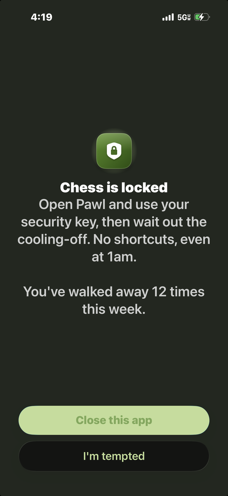
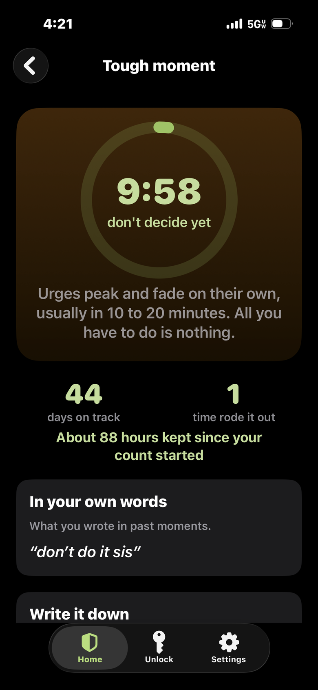
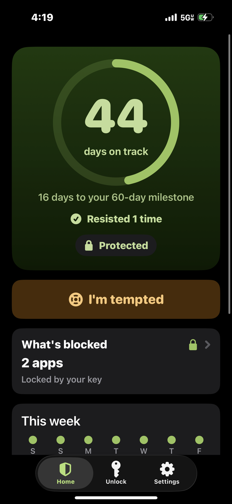
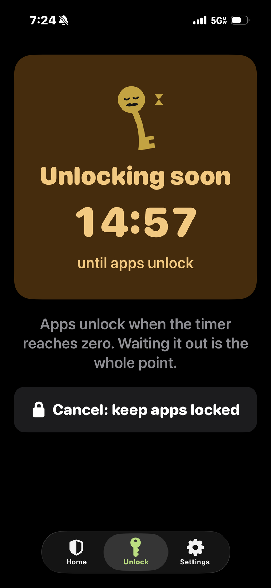
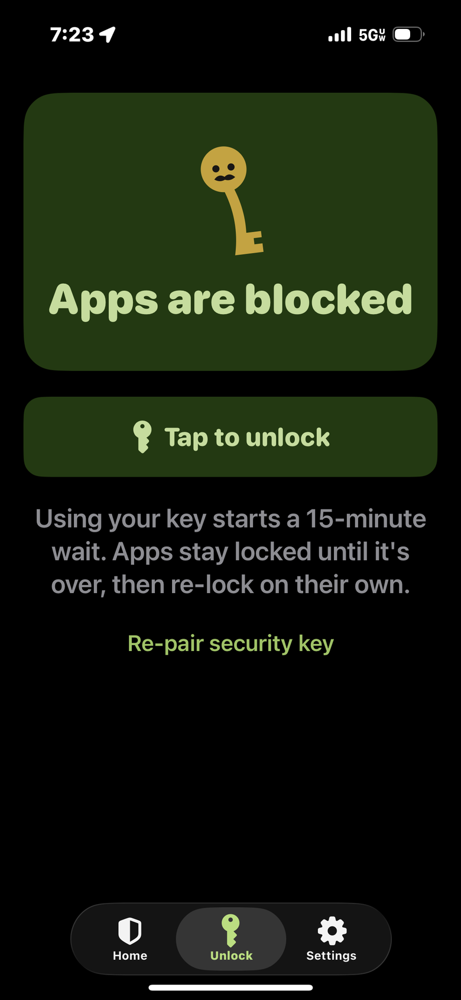
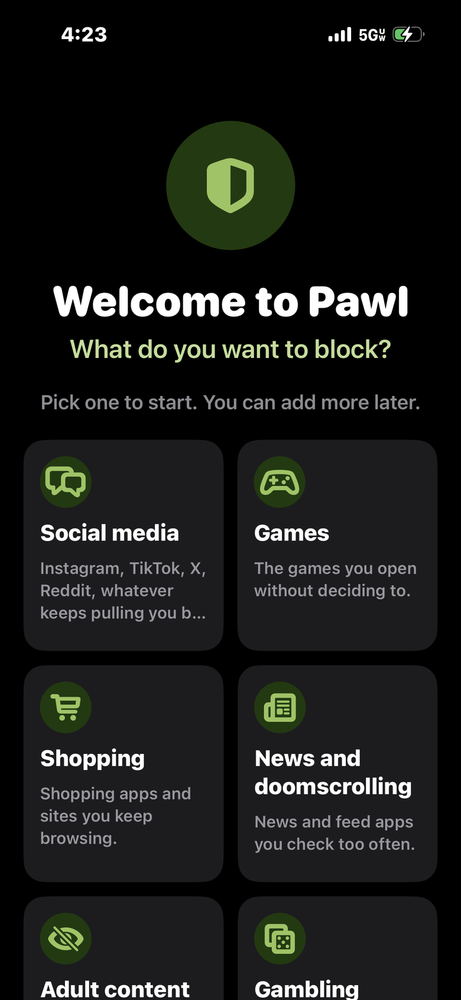
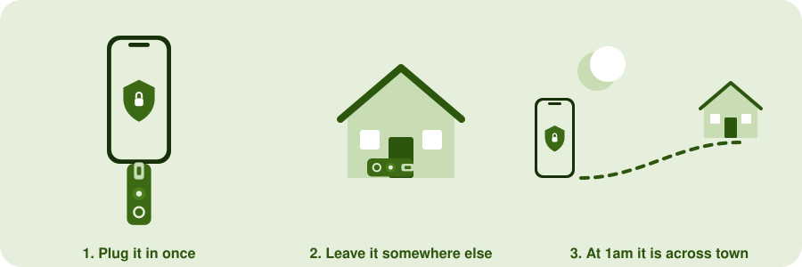
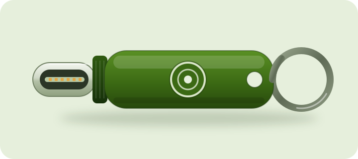

<p align="center">
  
</p>

<h1 align="center">Pawl</h1>

<p align="center"><b>An app and website blocker you unlock with a physical key.</b></p>

<p align="center">
  <a href="LICENSE"></a>
  
  
  
</p>

<p align="center">
  <a href="https://getpawl.com">Website</a> ·
  <a href="https://apps.apple.com/app/id6783119309">App Store</a> ·
  <a href="https://getpawl.com/privacy.html">Privacy</a> ·
  <a href="SECURITY.md">Report a vulnerability</a>
</p>

<p align="center">
  
  
  
  
  
  
</p>

---

Most blockers can be undone by the same person who set them up, in about
thirty seconds, at exactly the moment they most want to. That is the moment
Pawl is built for.

Pawl blocks any apps and websites you pick, using Apple's Screen Time. There
is no way to lift the block from the phone alone. To lift it you need a physical FIDO2 security key (a YubiKey, for example) that you
plugged in once and then put somewhere hard to reach: a friend's house, your
car, a drawer at work. Even with the key, you wait (fifteen minutes unless you
change it) before anything opens, and the block comes back on by itself.

A real example: it is 1am and you open the app you told yourself you were
done with. You see Pawl's block screen. The key is at your sister's place
across town. By the time you could get it, and then wait out the fifteen
minutes, the urge has usually passed. That is the whole idea.

You choose what Pawl blocks. Some people block betting apps, some block adult
sites, some block the three apps that eat their evenings. Pawl does not care
which, and never learns the names of the apps you pick.

## Status, plainly

| | |
|---|---|
| Stage | Live on the [App Store](https://apps.apple.com/app/id6783119309), iPhone and iPad. |
| Audit | **None.** Nobody independent has reviewed the code. |
| Team | One developer. No company, no funding, no investors. |
| Platform | iPhone and iPad, iOS 18 and later. No Android, no Mac. |
| Backend | **None.** No server, no account, no sign-in. Everything stays on your phone and in your own iCloud. (Up to 2.2, an optional ally feature used a Supabase server. 2.3 removed it.) |
| Tracking | No analytics, no ads, no crash reporter. |
| Price | Blocking, the key, the wait, your streak and the urge tools are free. Pawl Pro, a subscription, adds making new scheduled sets and the weekly report. Sets you made before Pro existed keep working free. The Pro code is in this repo too. |

## What it does not promise

Read this before you trust it with anything.

- **iOS lets the owner of a phone turn Screen Time off.** No app can stop
  that. Pawl can only notice it the next time it runs, and it tells no one:
  there is no server to send an alert. For a real lock, someone you trust sets
  the Screen Time passcode in person and keeps it (the "hard lock" flow). iOS
  enforces that passcode, not Pawl.
- **The key check.** Since 2.1 (the version on the App Store today) Pawl
  checks the key's whole response on the phone: the challenge it just
  issued, the hash of `getpawl.com`, the "user present" flag, a signature
  counter that must go up, and the ES256 signature against the public key
  saved when you paired. What it still cannot do: it does not check that the
  key is genuine hardware from a known maker (no attestation check), and a key
  paired on 2.0 has no saved public key, so its signature is not checked until
  you pair it again. Before 2.1, Pawl only checked that the credential ID
  matched. All of this runs on your phone, so on a jailbroken phone
  none of it holds. See `Pawl/Domain/WebAuthnVerifier.swift`.
- **The clock lock is not yet proven.** Since 2.1 Pawl turns on Screen
  Time's "require automatic date and time" while it is protecting you
  (`ShieldService.setClockLock`), so moving the clock forward should not
  shorten the cooling off wait. Whether iOS enforces that for an app using
  individual Screen Time permission has not been confirmed on a device yet.
- **Debug builds have developer buttons.** "Skip the wait" and "allow
  deletion" exist for testing. They sit inside
  `#if DEBUG`, which is only switched on in the Debug build setting, so they
  are not in the App Store build. If you build Pawl yourself in Debug, you
  get them. That is on purpose: it is your own phone.
- **No blocklist is complete.** The optional gambling list ships 167 domains,
  built into the app, and the adult filter is Apple's. New sites appear every week. Sites
  you type in yourself are blocked exactly as typed.
- **A determined person can get around any blocker on a phone they own**
  (another phone, a laptop, a friend's device). Pawl makes the 1am version
  slow. It does not make it impossible.
- **Most of the code has no automated tests.** The unlock loop and the key
  check do. The rest was tested by hand on real phones.
- **No reproducible builds.** You cannot prove the App Store binary was built
  from this exact source.

## How it works

1. **Pick what to block.** Apps and websites, through Apple's own Screen Time
   picker. Pawl never learns the names of the apps you pick. Apple hands it an
   opaque token.
2. **Register a security key.** Tap it to your phone once. Then put it
   somewhere that takes real effort to reach. Any FIDO2 key with a USB-C
   plug works.

   

   

3. **The shield goes on.** While a commitment is active, Pawl also turns on
   Screen Time's "block app deletion", so you cannot delete Pawl to get out.
4. **When you want out,** you tap the key, then wait out the cooling off
   period (15 minutes to start). After the open time (30 minutes to start) the
   shield comes back on by itself. Since 2.4 you choose both: any wait from none
   to 24 hours, and any open time from 15 minutes to 12 hours, or "until I lock
   it". Stricter choices apply at once. Looser ones (a shorter wait, a longer
   open time) only apply after your current wait, so there is no shortcut in
   the moment.
5. **The key is the accountability.** Give it to someone you trust, like your
   sister across town. Whoever holds the key decides when Pawl can loosen.
   They don't install anything and nobody makes an account.
6. **Your clean day streak survives deleting the app.** It lives in your
   iCloud, not on the phone.

Slipping up is treated as normal. The relapse log is private to you, and
nothing in the app scolds you for using it.

## Where your data goes

| Data | Where it lives | Who can see it |
|---|---|---|
| Which apps and sites you block | Your phone and your iCloud (as Apple's opaque tokens) | You |
| Streak, relapse log, urge log | Your phone and your iCloud | You |
| Your registered key's credential ID | Your phone (the app's shared storage) | You |
| Whether you have Pawl Pro | Apple (the App Store handles the purchase) | You. Pawl only learns whether Pro is active |

Pawl has no server. Nothing in this table leaves your phone except to your own
iCloud. Up to 2.2, an optional ally feature kept accounts, unlock requests and
check-ins on a Supabase server. 2.3 removed that feature, along with sign-in
and push notifications. On first launch after updating, the app clears what it
left on the phone (`Pawl/Services/LegacySponsorCleanup.swift`).

## Check it yourself

The best thing a stranger can do today is read. Start here:

| File | What |
|---|---|
| `Pawl/Domain/UnlockMachine.swift` | The whole unlock loop, as a pure function with no iOS code |
| `PawlTests/UnlockMachineTests.swift` | 9 tests for that loop |
| `Pawl/Domain/WebAuthnVerifier.swift` | The key check (2.1), and what it still cannot prove |
| `PawlTests/WebAuthnVerifierTests.swift` | 28 tests for the key check, with synthetic key data |
| `Pawl/Services/SecurityKeyService.swift` | Talking to the key through Apple's AuthenticationServices |
| `Pawl/Services/ShieldService.swift` | Applying and lifting the shield, the app deletion block |
| `Pawl/Services/DurationSettings.swift` | Why making the wait shorter is itself delayed |

Security fixes are explained in a comment at the spot where they happened.
Search the code for `SECURITY FIX` to find them.

## Where things are

| Path | What |
|---|---|
| `Pawl/Domain/` | Pure logic: the unlock loop, streaks, models |
| `Pawl/Services/` | iOS code: shield, key, iCloud, StoreKit |
| `Pawl/Features/` | SwiftUI screens |
| `PawlShield/` | The block screen you see when you open a blocked app |
| `PawlShieldAction/` | The buttons on that block screen |
| `PawlMonitor/` | The Screen Time extension that puts the shield back on schedule |
| `PawlTests/` | Unit tests |
| `site/` | getpawl.com, static HTML |
| `docs/` | Requirements, design and setup documents (`docs/archive/` holds the retired server and ally docs) |

Some code comments point to planning documents (for example `docs/12` or
`docs/16`) that are not in this repo. Those were business planning notes. The
requirements (`docs/01_SRS_Pawl.md`) and design (`docs/02_SDS_Pawl.md`) are
here.

## Building

```
git clone https://github.com/jasonepage/Pawl.git
open Pawl/Pawl.xcodeproj
```

You need Xcode 26, an iPhone on iOS 18 or later (Screen Time does not work in
the simulator), and a paid Apple Developer account. Apple must also approve
the Family Controls entitlement for your team before the blocker will run
outside development. The security key needs a domain you own with an
`apple-app-site-association` file; change `PawlConfig.relyingPartyID` to it.
Setup steps are in `docs/04_Xcode_Setup_Checklist.md` and
`docs/05_Security_Key_Setup.md`.

Run the tests in Xcode with Product, then Test.

## Contributing

Bug fixes, tests and documentation are welcome. Keep the MPL notice at the top
of every new source file. Anything that touches the user's words on screen
should stay plain and kind: the people using this are having a hard time, and
the app must never shame anyone for a relapse.

A security finding goes to [SECURITY.md](SECURITY.md), not a public issue.

## License

[Mozilla Public License 2.0](LICENSE), the same as
[Seal](https://github.com/jasonepage/Seal). You may read, audit, run and fork
this. Changes to Pawl's own files have to be published under the same license.
MPL rather than GPL on purpose: GPL family licenses conflict with the App
Store's terms, and a blocker that cannot ship on the App Store helps nobody.
